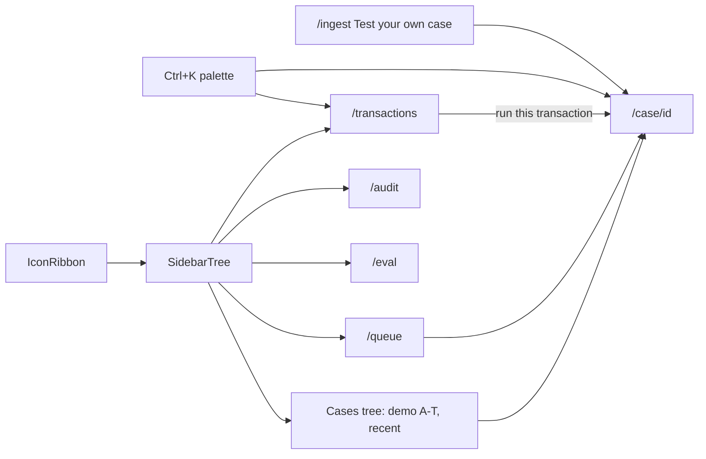

# GulfHorizon UI plan: "Obsidian Ledger"

A dark, desaturated-green operations console in the spirit of Obsidian community themes (Minimal, Things, Primary, Blue Topaz, Sanctum): sharp, dense and calm, with purposeful motion. This document is the step 1 deliverable. Step 2 builds the design system and `/styleguide`; step 3 builds the screens. Each step stops for review.

Hard rules: corner radius 0 to 2px; no pills, capsule badges, drop-shadow cards, decorative gradients or emoji; 1px hairlines on a strict 4px grid; depth from surface tint only; monospace with tabular numerals for IDs, amounts, hashes and timestamps; self-hosted fonts; EN and AR with RTL for memo and report panels; WCAG AA; `prefers-reduced-motion` respected. Frontend only: never import the engine or change backend code.

## What exists today
- **API client:** [frontend/lib/api.ts](../frontend/lib/api.ts) covers:
  - health, cases, case detail, run, decide, commit;
  - transactions, runTransaction, timeline, fileReport, reset.
- **Routes on the backend but not yet in the client:**
  - `GET /records/{id}`, `GET /cases/{id}/report`, `GET /cases/{id}/audit`;
  - `GET /audit/verify`, `POST /cases/ingest`.
- **Types:** [frontend/lib/types.ts](../frontend/lib/types.ts) mirrors the backend, with drift to fix in step 2:
  - `Health` lacks `investigator_model`, `investigator_live` and `backup_model`, and `demo_mode` lacks `off`;
  - `Approval` lacks `action` and `override`;
  - `Evidence` lacks `calls`.
- **Current UI:** [frontend/components/CaseScreen.tsx](../frontend/components/CaseScreen.tsx) (655 lines) plus `ui.tsx` and `HighlightedText.tsx`. Step 3 replaces them; the span-merge logic gets reused.
- **Styling and dependencies:**
  - Tailwind v4 with `@theme` tokens in [frontend/app/globals.css](../frontend/app/globals.css).
  - Next 16.4. Per [frontend/AGENTS.md](../frontend/AGENTS.md), read `node_modules/next/dist/docs/` before writing code, especially for `next/font/local` and route groups.
  - Approved but not installed ([DEPENDENCIES.md](DEPENDENCIES.md)): `motion` and `@tanstack/react-query`. These are the only packages step 2 adds.
  - No icon library: a small inline SVG icon set.
  - No markdown library: a renderer for the subset the report template uses (h1/h2, blockquote, table, list, inline code and `[ID]` citations).

## API gaps (tell, don't fake)
1. **`/eval` scorecard:** there's no eval endpoint and no eval output file, and the API deliberately withholds the ground-truth labels. The screen shows a "needs `GET /eval`" blocked state until the backend adds it.
2. **Global `/audit` table and its verify sweep:** only per-case audit and `/audit/verify` (head hash and count) exist. A global table needs `GET /audit?limit&offset`. Until then the screen shows verify status plus a per-case chain view.
3. **Queue KPIs:** `last_route` is held in memory, is null until each case is run, and clears when the backend restarts.
   - A "Run queue" action calls the real `POST /cases/{id}/run` one case at a time, with progress shown. This is safe in replay mode; in live mode it is rate-limited.
   - A persisted route on `/cases` would remove the problem; that needs a backend change.
4. **"Cited by" across cases** (for example, every case citing WL-007): no endpoint. Backlinks within one case are built from report sentences, investigator findings and timeline record IDs.
5. **Arabic report:** the SAR template is English only. Memo, raw-field and record panels get `dir="auto"` and RTL. A full Arabic report needs a backend template.
6. **Entity graph counterparties:** one payee per case and no cross-case counterparty IDs, so mule-graph correlation needs a backend endpoint. A graph for a single case is buildable from the evidence data.

## Information architecture

- **Shell:**
  - Icon ribbon, 44px.
  - Collapsible sidebar tree, 224px.
  - Pane tabs, 32px: open cases and pages, like Obsidian tabs.
  - Workspace.
  - Status bar, 24px. It shows:
    - backend health;
    - provider (Groq live, backup, or replay, from `/health`);
    - audit chain (`/audit/verify`, polled every 30 seconds);
    - case count;
    - role switcher (Analyst / Officer), which the decision endpoint needs.
- **`/` redirects to `/queue`.** The Reset button appears only when `NEXT_PUBLIC_DEV_TOOLS=1`, in the palette and status bar, and asks for the admin token.
- **Labels:** the backend's `LLM` actor is displayed as `MODEL` everywhere.

## Layout grid
- **Spacing and borders:**
  - Base unit 4px; every margin, padding and gap is a multiple of 4.
  - Panel padding 12px; tile gap 8px.
  - 1px hairline borders, radius 0 (2px only on focus rings and inputs).
- **Bento:**
  - The workspace is a 12-column grid with 8px gutters and rows aligned to 4px.
  - Depth comes from surface tint (bg, then surface, then raised), never from shadows.
- **Case screen** at 1440px or wider: timeline 320px, centre flexible, decision rail 344px. Below 1280px the timeline collapses into a drawer.
```
+--------------------------------------------------------------------------------+
| tabs: [ALT-00033 x] [Queue] [Transactions]                                     |
+-----------------+------------------------------------------+-------------------+
| PIPELINE        | [Quarantine] [Evidence] [Report]         | DECISION          |
| received   CODE | +--------------------------------------+ | route  reasons    |
| regex      CODE | | AIRLOCK raw -> scanner -> tray       | | code vs final     |
| classifier MODEL| |        -> MemoFacts -> gate -> inv   | +-------------------+
| evidence   CODE | +------------------+-------------------+ | APPROVAL GATE     |
|  - kyc  0.4ms   | | regex verdicts   | classifier/segs   | | role, reason      |
|  - sanctions    | +------------------+-------------------+ +-------------------+
| investigator    | | MemoFacts table  | raw fields (RTL)  | | FILING GATE       |
| verifier / gate | +--------------------------------------+ | hash, cited IDs   |
+-----------------+------------------------------------------+-------------------+
| status: backend ok | replay | chain ok AUD-000412 | 100 cases | role: Officer   |
+--------------------------------------------------------------------------------+
```
- **Queue:** KPI strip (4 tiles with count-ups) above a toolbar (lane segmented tabs, rule, amount band, search) above a dense table. Each row has a left status bar in its route colour and a demo-tag pin.
- **Transactions:** a toolbar (search; alerted / not alerted / all segments; currency; amount range; sort) over a virtual-scroll table of all 1,000 rows from a single `limit=1000` call. Each row has a "Run" action. Rows without a rule-raised alert get a "Not alerted by rules" tag.

## Tokens (proposed; frozen in step 2 after a browser check)
- **Colours:**
  - Base: bg `#0A0E0C`, surface `#0F1512`, raised `#141C17`, hairline `#213028`, text `#D6E0D9`, muted `#7B8B82`.
  - Semantic: sage `#6E9B83` (CODE and positive), amber `#C9A24A` (review), red `#B5524A` (blocked and hostile), MODEL steel `#7C9DB8`, HUMAN sand `#C8B47A`.
- **Contrast fixes:**
  - Red `#B5524A` on bg is about 4.0:1, which fails AA for small text. Add `red-text #D27A70` and keep `#B5524A` for bars, borders and fills.
  - muted is about 5.4:1 on bg and 4.8:1 on raised, which passes AA.
- **Type:**
  - Geist for UI at 12, 13 (base), 14, 16, 20 and 28px.
  - JetBrains Mono with tabular numerals for IDs, amounts, hashes and timestamps.
  - IBM Plex Sans Arabic for Arabic, with a +2px size bump and 1.7 line height.
  - All self-hosted as woff2 files in `frontend/app/fonts/` (OFL licence files included) and loaded with `next/font/local`. No CDN and no font package.
- **Backdrop** (app background only):
  - static SVG noise grain at 3% opacity;
  - an 8px grid made of hairlines at 4% opacity.

## Component inventory
- **Shell:** `Ribbon`, `SidebarTree`, `PaneTabs`, `StatusBar`, `CommandPalette` (Ctrl+K: jump to an ALT or TXN ID, run a transaction, open a page).
- **Primitives:**
  - `Panel` and `Tile` (bento cells, three surface tints);
  - `Button` (solid, outline, ghost; square corners);
  - `SegmentedTabs`;
  - `Field`, `Select`, `TextArea`;
  - `DataTable` (sticky header, virtual rows, left status bar);
  - `Tag`, `ActorTag` (CODE solid, MODEL outlined, HUMAN dashed) and `RouteTag`;
  - `Kbd`;
  - `Callout` (note, warn, danger, refused);
  - `PropertiesTable` (frontmatter style);
  - `Num` (mono, tabular), `Hash` (shortened, copy on click), `CountUp`;
  - `Skeleton`, `EmptyState`, `ErrorState`, `RefusedState`, `Banner` (replay or degraded);
  - `Drawer`, `HoverCard`, `Tooltip`.
- **Records:** `RecordChip` (link style), `RecordPreview` (hover, `GET /records/{id}`, cached), `RecordDrawer` (raw record, withheld columns noted, Backlinks within the case).
- **Case:**
  - `PipelineTimeline` (from `/cases/{id}/timeline`, grouped by run), `Airlock`, `QuarantinePanel`, `EvidencePanel`;
  - `ReportDocument` (properties table, callouts, citation chips, rejected-sentence counter);
  - `DecisionCard`, `ApprovalGate`, `FilingGate`;
  - `EntityGraph` (P2, hand-rolled SVG force layout).
- **Other screens:** `KpiStrip`, `QueueTable`, `TxnToolbar`, `TxnTable`, `ChainTable`, `VerifySweep`, `IngestForm`.

## State handling
- **Every data view** has four explicit states:
  - loading: static skeleton blocks, no shimmer;
  - empty: what is missing and the action that fills it, such as "Not run yet: Run case";
  - error: the `ApiError` status and message, a retry button, and "backend unreachable" taken from the status bar's health check;
  - refused: a 403 from decide, commit or file shows the backend's detail in a `refused` callout, with a link to the new audit entry. A 409 shows the conflict ("already filed as AUD-...").
- **Degraded:** if the investigator status is not `ok`, or the classifier is degraded or hits the segment cap, show a "Failed closed to human review" callout. Replay mode shows a persistent banner.
- **Server state:** TanStack Query caches it, with no refetch on window focus. Mutations invalidate case, timeline, report and audit. Nothing is fetched on the server; the pages are client components.

## Motion spec
- **Tokens:**
  - durations: fast 120ms, base 180ms, slow 320ms;
  - easings: `out` cubic-bezier(0.2,0,0,1), `inOut` cubic-bezier(0.4,0,0.2,1), linear for the scanner.
  - Everything goes through `lib/motion.ts`, which reads `useReducedMotion`. Reduced motion means a duration of 0 and the final state rendered directly.
- **Airlock** (6.0s at 1x; speed 0.5x / 1x / 2x; Replay button):
  - 0.0–0.6s: raw memo slides in from the left (x -24 to 0, fade, `out`).
  - 0.6–2.4s: a hairline scanner sweeps (linear). As it reaches each span, the span flashes red for 160ms.
  - 2.4–3.4s: flagged spans are cut out and drop into the "Neutralized" tray (layout animation, 320ms). The tray count counts up.
  - 3.4–4.6s: typed MemoFacts rows assemble at an 80ms stagger.
  - 4.6–5.4s: the gate's two hairline doors part, and the facts move to the investigator box.
  - 5.4–6.0s: "raw text received by investigator: 0" settles with a single pulse.
  - The spans are real raw-text offsets from `quarantine.spans` (mapped back from normalised text by the backend).
- **Pipeline timeline:**
  - Steps reveal at a 90ms stagger (fade, y 4 to 0, 180ms). Service-call rows follow at a 40ms stagger, and duration bars grow over 240ms.
  - This plays only on a new run, not on refetch.
- **Other motion:**
  - KPI count-ups: 600ms, `out`, once per mount.
  - Verify sweep: each row lights in sequence at 24ms per row, capped at 1.2s total. Valid rows get a sage left bar; the sweep stops red at the first bad row.
  - Gate unlock: one 400ms sage outline pulse.
  - Drawer: 180ms slide plus fade. HoverCard: 120ms fade after a 250ms delay.
  - Nothing else moves: no bounce, no parallax, no hover lifts.

## File and folder plan (frontend only; no backend changes)
- `app/fonts/*.woff2` plus OFL licences; `lib/fonts.ts`.
- `app/globals.css`: frozen `@theme` tokens, backdrop, focus rings, reduced-motion rules.
- `app/(console)/layout.tsx`: the shell. Pages under it: `queue/`, `case/[id]/`, `transactions/`, `audit/`, `eval/`, `ingest/`.
- `app/styleguide/page.tsx`: every component, plus the airlock alone, using fixtures only.
- `components/shell/*`, `components/primitives/*`, `components/records/*`, `components/case/*`, `components/queue/*`, `components/transactions/*`, `components/audit/*`, `components/icons.tsx`.
- `lib/api.ts` (add the missing routes), `lib/types.ts` (fix drift), `lib/queries.ts` (query hooks).
- `lib/format.ts` (AED amounts, timestamps, hash shortening), `lib/motion.ts`, `lib/markdown.ts`, `lib/i18n.ts` (a small EN/AR dictionary for chrome strings).
- `lib/fixtures/*`: imported only by `/styleguide`, never by a screen.

## Step 2 and step 3 outline (each stops for review)
- **Step 2:**
  - Install `motion` and `@tanstack/react-query`, add the fonts, and freeze the tokens.
  - Build the primitives, shell and record components, plus the airlock and timeline on fixtures, and `/styleguide`.
  - Run `npm run typecheck` and commit "UI 2/3: design system and styleguide".
  - Report what to screenshot.
- **Step 3**, one commit per screen in this order, each followed by a type-check and a screenshot list:
  1. `/case/[id]`
  2. `/queue`
  3. `/transactions`
  4. `/audit`
  5. `/eval` (blocked state until the endpoint exists)
  6. `/ingest`
  7. P2: entity graph, Arabic polish, ROI strip
  - The old `CaseScreen`, `ui` and `HighlightedText` components are removed when `/case/[id]` replaces them.
